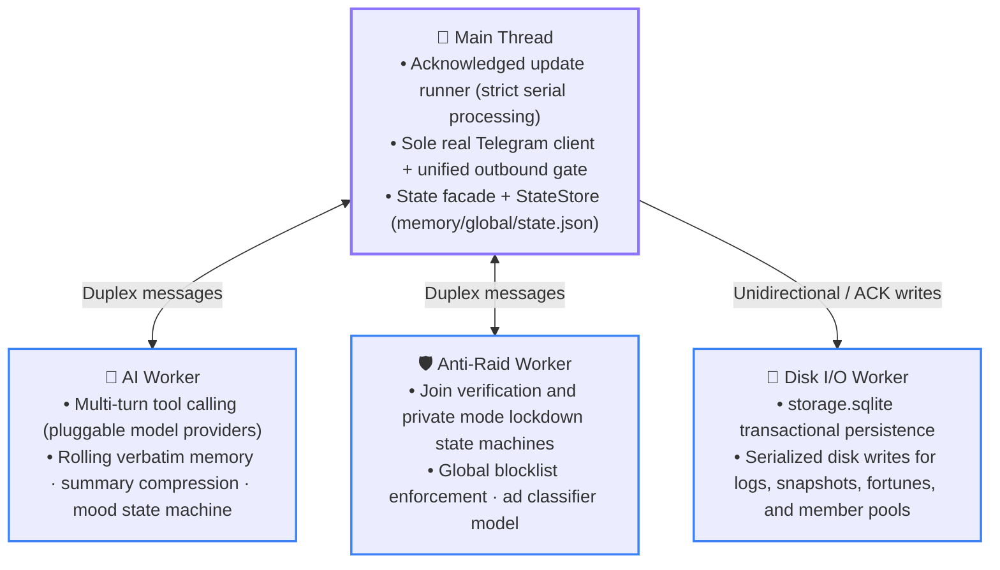
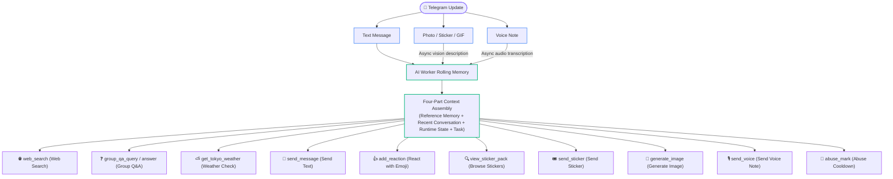

# 02 Architecture Overview

<p align="center">
  <a href="../cn/02-architecture.md">简体中文</a> · <b>English</b> · <a href="../ja/02-architecture.md">日本語</a>
</p>

<p align="center">
  <a href="content-table.md">📚 Developer Docs Home</a> · <a href="01-getting-started.md">← Prev: 01 Setup</a> · <a href="03-directory-map.md">Next: 03 Directory Map →</a>
</p>

---

This document describes Copy Ninjia's core system architecture, multi-threaded topology, end-to-end message lifecycle, and startup/shutdown state machines. For authoritative execution contracts and state ownership boundaries, see [04 Authoritative Runtime Invariants](04-invariants.md).

## Topology: Main Thread + Three Workers



The system strictly follows the principle of **Single Ownership**: every piece of mutable runtime state is owned by exactly one authoritative thread at any given instant. Threads communicate exclusively via structured messages across process boundaries and never share mutable memory.

### Division of Labor Across Four Threads

- **🧵 Main Thread**
  - **Networking & Coordination**: Hosts the long-polling Telegram update runner, maintains the sole grammY Bot instance, orchestrates the unified outbound request gate, and supervises all three Worker threads.
  - **Authoritative In-Memory Mirrors**:
    - `cache/main/storage.ts`: Mirrored global state (`memory/global/state.json`) for copying targets and daily speech synthesis usage.
    - `cache/main/assets.ts`: Hot snapshot of `config/dynamic/assets.json` (avatars, thumbnails, image library path).
    - `cache/main/chatState.ts`: Hot read cache for `chat_states` (up to `STATE_MANAGED_CHAT_LIMIT` managed chats: feature switches, lockdown records, permission snapshots, titles, relays, and translation sessions).
  - **Direct State Writing**: Atomically updates `state.json` via the `StateStore` business facade.
  - **Proxy Execution for Telegram**: Handles all Telegram Bot API calls and media downloads requiring bot identity on behalf of workers. AI and Anti-Raid Workers call external model provider APIs directly.

- **🤖 AI Worker**
  - **Exclusive State**: Conversational memory (verbatim hot window + cold rolling summaries), reply admission quotas, media description queues, global AI mood, and whitelisted sticker catalogs.
  - **Responsibilities**: Multi-turn model interactions, dynamic tool orchestration, human-like typing simulation, and automated memory summarization.

- **🛡️ Anti-Raid Worker**
  - **Exclusive State**: Join verification challenge state machine, group lockdown state machine, and associated countdown timers.
  - **Responsibilities**: New member evaluation, challenge timeout kicking, spam classification pipelines, and global blocklist enforcement. Network side-effects are routed back to the main thread's outbound gate via duplex IPC messages.
  - **Self-Healing & Replay**: Automatically re-populates in-memory states from main-thread recovery mirrors if the worker crashes; recovers historical state from disk logs on process restart.

- **💾 Disk I/O Worker**
  - **Exclusive Persistence**: Exclusively serializes all disk reads and writes for `database/storage.sqlite`, `logs/`, and all domain subdirectories under `memory/` (except `global/`).
  - **Transactional Guarantees**: Enforces durability via atomic Write-Through transactions and exact revision acknowledgements.

### Module Boundaries and Worker Supervision

- **Thin Public Decoupling**: [`packages/aiChat/index.ts`](../../packages/aiChat/index.ts) and [`packages/antiRaid/index.ts`](../../packages/antiRaid/index.ts) serve as stateless public facades. AI supervision resides in [`workerBridge.ts`](../../packages/aiChat/workerBridge.ts) and message ingress in [`messageIngress.ts`](../../packages/aiChat/messageIngress.ts); Anti-Raid supervision is managed by [`workerBridge/controller.ts`](../../packages/antiRaid/workerBridge/controller.ts) and durable delivery by [`durableDelivery.ts`](../../packages/antiRaid/durableDelivery.ts).
- **Pure State Transition Separation**: Verification logic is strictly partitioned across join, pending, terminal, disable, and adopt phases (in `packages/states/verification/`); lockdown logic is partitioned across apply, persistence, restore, announcement, and adopt phases (in `packages/states/lockdown/`).
- **Supervision & Recovery Mechanism**:
  - AI and Anti-Raid Workers utilize [`packages/infra/supervisedWorker.ts`](../../packages/infra/supervisedWorker.ts), which throttles restarts within a rate-limited restart budget on crashes and replays the latest state mirror from the main thread.
  - Disk I/O Worker crash recovery is independently managed in [`packages/infra/diskIO.ts`](../../packages/infra/diskIO.ts). The recovery phase remains strictly read-only until database verification, mirror replay, and queue drains succeed; any failure triggers an immediate fail-fast process exit.

---

## The Journey of a Message

All incoming update handlers are explicitly registered in [`packages/app/registerHandlers.ts`](../../packages/app/registerHandlers.ts), and the whole chain is registered through a single `bot.use`: that layer records the update ID and applies the bot-message limit, then enters the preamble chain in [`packages/app/updatePreamble.ts`](../../packages/app/updatePreamble.ts). Each preamble step calls the next one synchronously in the order shown below and returns a Promise only when it actually hits I/O (prefetching cold identities, a claiming ingress waiting on persistence or the network, command and message handlers). Slash commands, CJK action commands, and non-message updates such as reactions, member changes, and inline callbacks are built as grammY `Composer`s that the preamble calls at their positions. Global message ordering is enforced by the acknowledged update polling runner ([`packages/app/updateRunner.ts`](../../packages/app/updateRunner.ts)): it fetches updates using `UPDATE_POLL_LIMIT` and `UPDATE_POLL_TIMEOUT_SECONDS` and awaits full middleware completion before requesting the next batch.

```text
[Telegram Update]
       │
       ▼
 1. update_id Tracking       ── Records highest processed update_id to set offset upon graceful shutdown
       │
       ▼
 2. Inbound Bot Rate Limiting── Messages from other bots are rate-limited per ID across chats; excess drops silently; deletion targets in the chat are not counted
       │
       ▼
 3. Signed Fortune Receipt   ── Resolves inline draw confirmation receipts immediately
       │
       ▼
 4. /init & Private Gateways ── Blocks uninitialized groups; private chat strictly permits super-admin /send
       │
       ▼
 5. Identity Warm-Up         ── Prefills in-memory identity caches for all visible participants in this update
       │
       ▼
 6. Private /send Relay      ── Active private relay sessions route non-command messages directly to group dispatch
       │
       ▼
 7. Join Verification Ingress── Runs before commands; captures and evaluates messages from unverified users
       │
       ▼
 8. Delete Target Ingress    ── Enqueues messages from /delete_message targets for deletion and ends the chain
       │
       ▼
 9. Gag Muting Ingress       ── Intercepts and purges direct chat messages from restricted users
       │
       ▼
10. /qa Form Ingress         ── Claims and parses in-progress "问题:" / "回答:" question-answer form submissions
       │
       ▼
11. Command Sub-Chain (:entities:bot_command)
       │                     ── Filters non-commands; ordinary messages bypass this composer entirely
       ├─ /permission, /white, /copy, /translate, /wed, /block, /ai_chat ...
       └─ /x (menu placeholder guiding CJK action command usage)
       │
       ▼
12. CJK Action Commands      ── Matches Chinese action commands via CJK_ACTION_COMMAND_PATTERN (e.g. /咬, /贴贴) before fallback
       │
       ▼
13. Automatic Message Pipeline── auto/message/ handles copying, Q&A direct answering, and AI conversation triggers
```

Reactions (`message_reaction`) are handled by an independent listener (`auto/reactionSync.ts`) outside the primary message pipeline.

> [!NOTE]
> `bot.catch` logs unhandled errors and re-throws them so failed updates are not acknowledged.

---

## AI Message Processing Pipeline



### 1. Media Routing and Placeholder Pipeline

- **Text**: Immediately inserted into the context queue with physical timeline timestamps.
- **Photos / Stickers / GIFs**: Inserted with a placeholder first, then downloaded asynchronously in the background and described by the vision model. Once analyzed, descriptions backfill the placeholder in place. Whitelisted stickers hit an instant in-memory catalog description.
- **Voice Notes**: Queued with a placeholder and transcribed asynchronously by the audio model (prefixed as `[语音：<原话>]`). Oversized audio is rejected before downloading.

### 2. Reply Triggering and Four-Part Context

AI conversation is triggered via two paths:
- **Direct Trigger**: Mentions (@bot), explicit replies to the bot, or direct media messages.
- **Proactive Interjection**: Dynamically calculated probability based on recent chat velocity; cold chats have low participation probability, while active conversations scale up naturally (subject to cooldowns; suppressed during `/quiet`).

Upon trigger, the AI Worker assembles a four-part model prompt:
1. **Reference Memory** (`CURRENT_REFERENCE_MEMORY`): The bot's identity and rolling summaries of earlier conversations.
2. **Current Conversation** (`CURRENT_CONVERSATION`): Recent verbatim multimodal transcript and participant roster.
3. **Current Runtime State** (`CURRENT_RUNTIME_STATE`): Active mood, current time, and available tool quotas for this round (image cooldowns, remaining voice budget, Q&A status).
4. **Current Reply Task** (`CURRENT_REPLY_TASK`): Trigger metadata, reply instructions, and deliberate typo requirements (if drawn).

### 3. Tool Calling System and Action Budget

The model can execute multiple tool calls within a single round. All visible side-effect tools are subject to strict per-round quotas:

| Tool Name | Type | Behavioral Rules & Quota Limits |
| :--- | :--- | :--- |
| **`send_message`** | Action | Sends a text message. A fallback text is sent only if zero visible actions were produced during the turn. |
| **`add_reaction`** | Action | Adds an emoji reaction from the allowlist; bounded by `MAX_REACTIONS_PER_REPLY`. |
| **`view_sticker_pack`** | Query | Inspects stickers within a whitelisted pack; free query budget; must be inspected before sending. |
| **`send_sticker`** | Action | Sends a specific sticker; bounded by `MAX_STICKERS_PER_REPLY`. |
| **`generate_image`** | Action | Synthesizes and sends an image; verified against group cooldowns; bounded by `MAX_GENERATED_IMAGES_PER_REPLY`. Reference images from a direct trigger (album images filled in album order, at most `agent.image.max_reference_images`) are passed to the image model with the request. |
| **`send_voice`** | Action | Synthesizes voice audio matching `agent.tts.bot_language`; queued on the serial action chain; bounded by `MAX_VOICES_PER_REPLY`. |
| **`web_search`** | Query | Local web search tool (mounted when `agent.web_search` is configured); bounded by `max_calls_per_use`. |
| **`group_qa_query`** | Query | Lists registered Q&A questions in the current group; does not consume action budget. |
| **`group_qa_answer`** | Query | Fetches pre-registered answers for specific questions discovered via `group_qa_query`. |
| **`abuse_mark`** | Action | Marks the current trigger user to be ignored by AI chat for `ABUSE_MARK_DURATION_MS` when repeatedly requesting disallowed or pestering content, sends an atmosphere-specific notice, and immediately ends the model round. |
| **`get_tokyo_weather`** | Query | Queries Tokyo daily weather and temperature; mounted only when configured time zone is `TOKYO_TIME_ZONE`. |

> [!TIP]
> **Action Chain and Chat Action Simulation**:
> - Action tools reserve quota immediately at call time and return acceptance receipts to the model; typing pauses, speech synthesis, and Telegram API dispatches execute sequentially along a **serial action chain**.
> - Telegram chat status indicators (typing, recording voice, choosing sticker, uploading photo) reflect the action currently executing on the chain. After one status completes, at least `CHAT_ACTION_REST_MS` of quiet time elapses before the next status lights up.

---

## Startup Order

The entry point [`index.ts`](../../index.ts) solely delegates to [`ApplicationLifecycle`](../../packages/app/lifecycle.ts). Merely importing modules never starts background workers, timers, or network connections. `ApplicationLifecycle.init()` orchestrates startup sequentially:

0. **Configuration Layout Verification**: When `config/bot.ts` is imported, `layout.ts` ensures deployment files are organized strictly in `config/static/` and `config/dynamic/`.
1. **Data Root Preflight & Instance Locking**: `acquireSingleInstanceLock` tests data root capabilities (writable, fsync, same-directory hard-links, atomic renames, directory fsync), then acquires the `/proc`-based `bot.lock` single-instance lock. It then registers the worker fatal callback and initializes avatar, chat title, translation, gag, wed, and deferred command runtimes.
2. **Global State & Configuration Preflight**:
   - Cleans up orphaned temporary files from previous unexpected terminations.
   - Restores and strictly validates `memory/global/state.json` via `StateStore` (rejecting any legacy `state.json` or `state.json.bak` in the data root).
   - Validates all dynamic and static deployment JSON inputs.
   - Verifies permissions and filenames in the dedicated random image library directory.
3. **Disk I/O Worker Initialization & Data Recovery**:
   - Disk I/O Worker performs a read-only integrity scan across all persistence domains (database, logs, AI cache usage, sticker catalogs, fortune records, verification records, join logs, wed member pools).
   - Once all domains validate cleanly, it adopts ownership, runs startup maintenance, and schedules the daily maintenance cron (`DISK_IO_MAINTENANCE_CRON`) in the configured time zone.
   - The main thread loads in-memory caches (chat states, Q&A pairs, wed members), initializes the Telegram client, verifies that `super_admin_user_id` is neither on the blocklist nor targeted by `/delete_message`, and seeds sender identity and translation target caches.
4. **Handler Registration & Telegram Handshake**: Mounts global middlewares, registers command menus, and executes `bot.init()`.
5. **Business Worker Initialization & Scheduling**:
   - Launches AI Worker (when core AI config is ready) and hydrates conversation context, sticker catalogs, fortune state, and pending verification records.
   - Launches Anti-Raid Worker and restores verification and lockdown mirrors.
   - Starts the `cron.json` scheduler, `config/dynamic/` hot-reload file watchers, and the blocklist sweep scheduler.
   - Performs an initial blocklist sweep across groups where admin rights are confirmed before accepting new updates.
6. **Start Update Runner**: Starts the serial update polling runner, schedules wed member review, and starts low-priority asynchronous group title hydration.

---

## Shutdown Order

Shutdown is managed centrally by `ApplicationLifecycle` (`wait()` and `dispose()`) along sequential barriers defined by `SHUTDOWN_DRAIN_OWNERS` in [`packages/app/lifecycle/shutdown.ts`](../../packages/app/lifecycle/shutdown.ts):

1. **Quiesce (Close Ingress Gates)**:
   - Stops group title hydration, avatar queue, translation, gag, wed reservations, deferred commands, scheduled cron tasks, blocklist sweeps, and configuration hot-reload watchers. Any exception withholds the final update offset acknowledgement.
   - Stops the Telegram update runner to prevent pulling new updates.
2. **Bounded Drain (Drain In-Flight Work)**:
   - Signals cancellation to in-flight update handlers and waits within a bounded deadline (aborting and withholding offset acknowledgement on timeout), then awaits pending group title hydration tasks.
3. **Flush & Acknowledge Update Offset**: `flushAllToDisk` drains all owners and worker mailboxes in `SHUTDOWN_DRAIN_OWNERS` order and flushes them to disk. Only when every drain succeeds is the final processed `update_id` offset acknowledged to Telegram.
4. **Dispose (Terminate Workers & Release Lock)**:
   - Runs final cleanup in `SHUTDOWN_DRAIN_OWNERS` order: avatar queue, translation (then closes client), Anti-Raid, gag notices, `/qa set` forms, wed, deferred commands, scheduled tasks, target message deletion drain (`/delete_message` queue), unified delayed message deletions, AI memory flush (then terminates AI Worker), Telegram outbound queue (then closes outbound gate), and Disk I/O flush.
   - Terminates Anti-Raid and Disk I/O Workers (before terminating, the Disk I/O Worker commits remaining writes, runs a WAL checkpoint, and closes the shared SQLite database), and flushes final `StateStore` global state.
   - Classifies the shutdown outcome as `clean`, `offsetWithheld`, or `unsettled`. `bot.lock` is retained until process exit only on `unsettled`, and released otherwise; any non-`clean` outcome sets a non-zero process exit code.

---

<div align="center">

[← Prev: 01 Setup](01-getting-started.md) · [📚 Developer Docs Home](content-table.md) · [⬆️ Back to Top](#02-architecture-overview) · [Next: 03 Directory Map →](03-directory-map.md)

</div>
